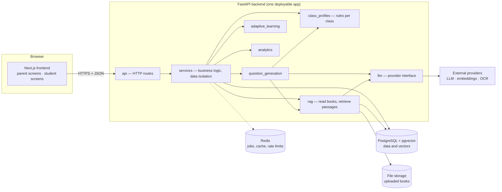

# 1. Architecture

## 1.1 What we are building

Not a chatbot. A system that runs this loop for every child and gets better each time round:

```
LEARN → PRACTICE → ASSESS → ANALYZE → IDENTIFY WEAKNESS → PERSONALIZE → PRACTICE AGAIN
```

The real goal: *understand what the child knows, find what the child does not know, and decide
what the child should learn and practise next.* Generating questions from PDFs is only one tool for that.

## 1.2 System overview



It is a **modular monolith**: one backend application with clear internal modules. That is the
simplest thing to run and debug, and any module can be moved into its own service later because
modules talk to each other through small interfaces, not through each other's tables.

## 1.3 Backend modules

| Folder (`backend/app/…`) | Responsibility | Built in |
|---|---|---|
| `core` | Settings, database session, security primitives, error format, logging, shared vocabulary (classes, boards, goals…), request size limits, the background `TaskQueue` | Step 1, 2 |
| `models` | Database tables (SQLAlchemy) | every step adds its own |
| `schemas` | Request / response shapes (Pydantic) | every step |
| `auth` | Sign-up, sign-in, tokens, child mode, "who is calling" | Step 1 |
| `class_profiles` | The rules for each class, Nursery–12 ([doc 7](07-class-aware-rules.md)) | Step 1 |
| `services` | Business logic. **Owns transactions and enforces who may see what** | every step |
| `api` | HTTP routes. Thin: read request → call service → shape response | every step |
| `rag` | Reading documents, structure detection, chunking, OCR interface, embeddings, retrieval ([doc 5](05-rag-pipeline.md)) | Steps 2–3 |
| `storage` | The `FileStorage` interface and the local-folder adapter for uploaded files | Step 2 |
| `llm` | One interface to language models; real providers behind it ([doc 6](06-llm-interfaces.md)) | Step 3 |
| `question_generation` | Generate → validate → regenerate; solutions and hints | Step 4 |
| `adaptive_learning` | Mastery, adaptive difficulty, weak topics, recommendations, misconceptions | Steps 7, 10 |
| `analytics` | Progress numbers for students and parents | Steps 4, 9, 11 |
| `utils` | Small helpers without business rules | as needed |

### Rules of the codebase

1. **Direction of calls:** `api → services → (domain modules) → models`. Routes never query tables directly.
2. **Services own the transaction.** A service that changes data calls `commit()` before returning,
   so data is saved before the response leaves.
3. **All family data is read through a service that filters by owner.** No exceptions (see 1.4).
4. **External providers sit behind interfaces** (LLM, embeddings, vector store, OCR, reranker, file
   storage). Business code never imports a provider's SDK directly.
5. **AI output is data, not text.** Every LLM answer is parsed into a Pydantic model and validated
   before anything else uses it.
6. **Anything that depends on the child's age reads the class profile.** No `if class > 5` scattered in code.
7. **No fake AI in the application.** Test doubles live only under `tests/`.

## 1.4 Identity and data isolation

The model is "one account, several learner profiles" — like profiles on a streaming service.

| Thing | Table | Meaning |
|---|---|---|
| Account | `users` | Someone who can sign in. Role `parent` or `student`. |
| Parent details | `parents` | One row per parent account. Children point to it. |
| Learner | `students` | A child added by a parent (**no login of their own**), *or* a student who signed up alone. |
| Learning profile | `student_profiles` | Class, board, medium, language, stream, goal, subjects. |

**Why children have no login:** a 5-year-old has no email, and Indian families usually share one
phone. Instead there is **child mode**: the parent taps a child, and the app receives a token that
still belongs to the parent's account but can only act as that one child.

Token claims:

| Claim | Parent session | Child mode | Student who signed up alone |
|---|---|---|---|
| `sub` (account) | parent's user id | parent's user id | student's user id |
| `role` (may act as) | `parent` | `student` | `student` |
| `sid` (limited to learner) | — | the child's id | their own learner id |

What a `student` session can do: see and practise as **that one learner only**. It cannot see
siblings, change name / class / board, add or remove children, or open any parent screen.
(A student who signed up alone may edit their own profile — there is no parent to do it.)

**The isolation rule.** Every row of family data is reachable from exactly one account. Every
query starts from the caller's account id, taken from the verified token — never from the request
body. Asking for something that belongs to another family returns **404, not 403**, so nobody can
even learn that it exists. The automated tests try every endpoint with a second family.

From Step 2, uploaded documents carry `owner_user_id` (the account in `sub`), so the same one-column
rule covers books, questions, attempts and everything derived from them.

## 1.5 Class-aware behaviour

There is one `ClassProfile` per class. It is the single source of truth for: language and question
complexity, explanation style, allowed question formats, session size, which features exist
(tests, timers, adaptive difficulty…), which goals and streams can be chosen, and the layout the
frontend uses. Details in [doc 7](07-class-aware-rules.md).

## 1.6 Swappable providers (Steps 2–3)

| Interface | Used for | Chosen with |
|---|---|---|
| `LLMProvider` | questions, solutions, explanations, validation, chat | `LLM_PROVIDER`, `LLM_MODEL_*` |
| `EmbeddingProvider` | turning text into vectors | `EMBEDDING_PROVIDER`, `EMBEDDING_MODEL` |
| `VectorStore` | storing and searching vectors — pgvector first | `VECTOR_STORE` |
| `Reranker` | re-ordering retrieved passages | `RERANK_PROVIDER` (may be `none`) |
| `OCRProvider` | scanned pages — Tesseract first (Step 2) | `OCR_PROVIDER`, `TESSERACT_CMD`, `OCR_LANGUAGES` |
| `FileStorage` | uploaded files — local folder first, object storage later | `STORAGE_BACKEND`, `STORAGE_DIR` |

Switching a provider means writing one small adapter class and changing an environment variable.

## 1.7 Background work

Reading a 300-page book (text extraction, OCR, embeddings) takes minutes, so it never runs inside
the upload request. The upload returns immediately; processing continues as a job whose progress is
stored on the document row, and the frontend shows it as a checklist. Each stage can be re-run
safely. Step 2 starts with an in-process worker behind a `TaskQueue` interface; Step 12 moves it to
Redis-backed workers without touching the callers.

## 1.8 Educational guardrails — where each one is enforced

| Guardrail (spec §41–42) | Enforced by |
|---|---|
| No hallucinated textbook facts | Answers are built only from retrieved passages; "not enough information" when retrieval is weak |
| Generated ≠ textbook questions | Every question stores `origin` (`textbook` / `generated`); the UI labels it |
| Cite chapter / page | Passages carry chapter, exercise and page; responses return them as `source` |
| Age-appropriate content | Class profile in every prompt + a validation pass |
| Hint before answer | The tutor follows a fixed ladder: hint 1 → hint 2 → concept → steps → answer |
| Never reveal system prompts | Prompt rules + output check; prompts are never sent to the browser |

## 1.9 Observability

Step 1 gives every request an id (`X-Request-ID`) and logs method, path, status and duration.
Later steps add retrieval latency, LLM latency, token usage, validation failures and user
feedback (spec §44). **Logs contain ids and counts — never children's names, answers or book text.**

## 1.10 Security and privacy

- Passwords hashed with Argon2id. Tokens are signed JWTs; access tokens are short-lived.
- Role checks and ownership checks on the server for every request.
- Uploads (Step 2): type checked by content, size and page limits, stored outside the web root
  under random names, never served directly.
- Secrets only in environment variables. `.env` is git-ignored.
- Planned for Step 12: rate limiting (especially sign-in), token revocation on sign-out, security headers.

**Children's data and Indian law.** The platform stores personal data of children. India's Digital
Personal Data Protection Act, 2023 requires verifiable parental consent before processing the
personal data of anyone under 18, and restricts tracking, behavioural monitoring and targeted
advertising aimed at children. The parent-owns-the-account design fits this well, but two things
need a lawyer's review before a public launch: (1) students under 18 signing up by themselves, and
(2) how the learning analytics are treated under the monitoring rules. This is an engineering note,
not legal advice.

## 1.11 Decisions taken where the spec left a choice

| # | Decision | Why |
|---|---|---|
| 1 | Children are profiles inside the parent's account, used through child mode | Young children have no email; families share devices; simplest strong isolation |
| 2 | Students may also sign up alone (spec §10) and then own their data | Older students often study without a parent's involvement |
| 3 | Email + password first; phone OTP later | OTP needs an SMS provider and costs per message; the `auth` module is separate so it can be added |
| 4 | Class codes are `nursery`, `lkg`, `ukg`, `class_1` … `class_12` | Readable, sortable through one helper, no magic numbers for pre-primary |
| 5 | Stream is required for Class 11–12 and refused below; JEE / NEET require Science | Question generation depends on it; avoids impossible combinations |
| 6 | Added a goal "Build strong basics" (`general_learning`) | "School exam" makes no sense as a goal for Nursery |
| 7 | Parent-facing upload progress uses plain words | The spec's checklist in §13 says "chunks / embeddings", but §47 forbids those words in the parent UI. §47 wins. See [doc 4](04-frontend-routes.md) |
| 8 | One book can be made of several files | NCERT publishes textbooks as one PDF per chapter |
| 9 | Each step adds its own migration | The database only ever contains tables that working code uses |
| 10 | Timestamps come from the application clock | The database clock is frozen inside a transaction, which breaks "order added" |
| 11 | Removing a child keeps the books made for them (they become family books) | Books are family material; a sibling may use them next year |
| 12 | Child mode can read the library but not change it | A child should not delete the family's books by accident |
| 13 | The same file can be in two different books, but not twice in one | Duplicates in a book double every search result; across books they can be intended |
| 14 | OCR is off by default and Tesseract must be installed separately | It is a system program, not a Python package; without it a scanned book gets a clear message instead of an empty result |
