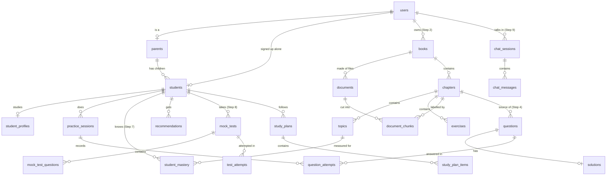

# 2. Database schema

PostgreSQL holds everything, including the vectors (through the `pgvector` extension) — one
database to run, back up and secure.

## 2.1 Conventions

| Topic | Rule |
|---|---|
| Names | `snake_case`, plural table names |
| Primary keys | UUID, generated by the application |
| Timestamps | `created_at`, `updated_at` on every table, stored with time zone (UTC) |
| Fixed vocabularies (role, class, board…) | Stored as lower-case text; the allowed values live in `app/core/enums.py`. A database `CHECK` is added only where a wrong value would break security (`users.role`) |
| Flexible data | `JSONB` (subjects, question bodies, chunk metadata) |
| Ownership | Every table with family data can be traced to one account. Deleting the owner deletes the rows (`ON DELETE CASCADE`) |
| Changes | Only through Alembic migrations — one per step, numbered `0001`, `0002`, … |

## 2.2 Tables that exist today (Step 1)

### `users` — accounts that can sign in

| Column | Type | Notes |
|---|---|---|
| `id` | uuid, PK | |
| `email` | varchar(320), unique | always stored lower-case |
| `password_hash` | varchar(255) | Argon2id |
| `full_name` | varchar(120) | |
| `role` | varchar(20) | `parent` or `student` — enforced by a CHECK |
| `preferred_language` | varchar(16) | language of the screens: `en`, `hi`, `hinglish` |
| `is_active` | boolean | `false` blocks sign-in |
| `last_login_at` | timestamptz, null | |

### `parents` — parent-only details

| Column | Type | Notes |
|---|---|---|
| `id` | uuid, PK | |
| `user_id` | uuid, unique, FK → `users.id` | one row per parent account |

Small today on purpose. Notification settings, phone number and plan details will live here.

### `students` — learners

| Column | Type | Notes |
|---|---|---|
| `id` | uuid, PK | |
| `parent_id` | uuid, null, FK → `parents.id` | set for a child added by a parent |
| `user_id` | uuid, null, unique, FK → `users.id` | set for a student who signed up alone |
| `name` | varchar(80) | |
| `age` | smallint, null | 2–25 |

CHECK: **exactly one** of `parent_id` / `user_id` is set.

### `student_profiles` — what the learner studies (one per student)

| Column | Type | Notes |
|---|---|---|
| `student_id` | uuid, PK, FK → `students.id` | |
| `class_level` | varchar(16) | `nursery`, `lkg`, `ukg`, `class_1` … `class_12` |
| `board` | varchar(16) | `cbse`, `icse`, `state`, `other` |
| `board_name` | varchar(80), null | e.g. "MP Board", only for `state` / `other` |
| `medium` | varchar(16) | medium of instruction at school |
| `primary_language` | varchar(16) | language the AI uses with this learner |
| `stream` | varchar(16), null | `science`, `commerce`, `arts` — Class 11–12 only |
| `goal` | varchar(32) | `general_learning`, `school_exam`, `board_exam`, `jee`, `neet`, `cuet`, `other` |
| `subjects` | jsonb | list of subject names |

Kept separate from `students` because it changes every year (promotion to the next class) while
the learner and their history stay the same.

## 2.3 The whole picture

Tables marked with a step number do not exist yet.



## 2.4 Planned tables

| Table | Step | Purpose | Important columns |
|---|---|---|---|
| `books` | 2 | An entry in "My Books": one textbook, notes set or paper collection | `owner_user_id`, `student_id?`, `title`, `material_type`, `class_level`, `board`, `subject`, `language` |
| `documents` | 2 | One uploaded file belonging to a book | `book_id`, `owner_user_id`, `original_filename`, `mime_type`, `size_bytes`, `sha256`, `storage_key`, `page_count`, `status`, `stage`, `error_code` |
| `chapters` | 2 | Detected chapter | `book_id`, `document_id`, `number`, `title`, `page_start`, `page_end` |
| `topics` | 2 | Section or concept inside a chapter | `chapter_id`, `title`, `position` |
| `exercises` | 2 | Exercise block, e.g. "2.3" | `chapter_id`, `label`, `page_start` |
| `document_chunks` | 2 | A labelled piece of text | `document_id`, `owner_user_id`, `book_id`, `chapter_id`, `topic_id?`, `exercise_id?`, `content_type`, `content`, `page_start`, `page_end`, `position`, `class_level`, `board`, `subject`, `language` |
| `document_chunks` + | 3 | Search columns | `embedding vector(N)`, `search_text tsvector`, indexes |
| `questions` | 4 | Textbook questions and generated ones | `owner_user_id`, `origin` (`textbook` / `generated` / `previous_year`), `chapter_id`, `topic_id?`, `exercise_id?`, `class_level`, `subject`, `format`, `style`, `difficulty`, `language`, `body` jsonb, `answer` jsonb, `hints` jsonb, `source` jsonb, `validation` jsonb |
| `solutions` | 4 | Concept → steps → final answer | `question_id`, `language`, `concept`, `steps` jsonb, `final_answer` |
| `practice_sessions` | 4 | One sitting of practice (not in the spec's list; needed to group attempts) | `student_id`, `scope` jsonb, `settings` jsonb, `status` |
| `question_attempts` | 4 | Every answer a learner gives | `student_id`, `question_id`, `practice_session_id?`, `test_attempt_id?`, `response` jsonb, `is_correct`, `time_taken_ms`, `hints_used`, `solution_viewed`, `difficulty` |
| `student_mastery` | 7 | The learner's knowledge profile | `student_id`, `topic_id`, `mastery`, `confidence`, `attempts`, `accuracy`, `avg_time_ms`, `last_practised_at` |
| `recommendations` | 7 | "Do this next", with the reason | `student_id`, `kind`, `payload` jsonb, `reason`, `status`, `valid_until` |
| `mock_tests`, `mock_test_questions`, `test_attempts` | 8 | Tests with sections and timing; results | `student_id`, `settings` jsonb, `section`, `position`, `marks`, `score`, `started_at`, `submitted_at` |
| `study_plans`, `study_plan_items` | 8 | Plan and its daily tasks | `student_id`, `exam_date`, `daily_minutes`, `target_score`, `day`, `task` jsonb, `status` |
| `chat_sessions`, `chat_messages` | 9 | Parent assistant and student tutor conversations | `owner_user_id`, `student_id`, `kind`, `role`, `content`, `sources` jsonb |
| `student_misconceptions` | 10 | Repeated wrong patterns | `student_id`, `topic_id`, `pattern`, `evidence` jsonb, `status` |
| gamification tables | 11 | Streaks, XP, badges | decided in that step |

`?` marks an optional column. Exact columns are fixed in the step that creates the table; this list
is the plan, not a promise.

**Why `books` and `documents` are separate:** NCERT publishes a textbook as one PDF per chapter. A
parent should see *one* "Class 8 Mathematics" in the library even if it arrived as 13 files.

**Why class, board and subject are repeated on `document_chunks`:** retrieval filters on them in
the same query that ranks by similarity (spec §16). Copying three short columns avoids three joins
on the hottest query in the system.

## 2.5 Changing the schema

```bash
# inside backend/, after editing a model in app/models/
alembic revision --autogenerate -m "documents and chunks" --rev-id 0002
# read the generated file in alembic/versions/ and tidy it
alembic upgrade head
pytest tests/api/test_migrations.py
```

`test_migrations.py` fails if a model and the migrations disagree, and checks that every migration
can be undone and applied again.
