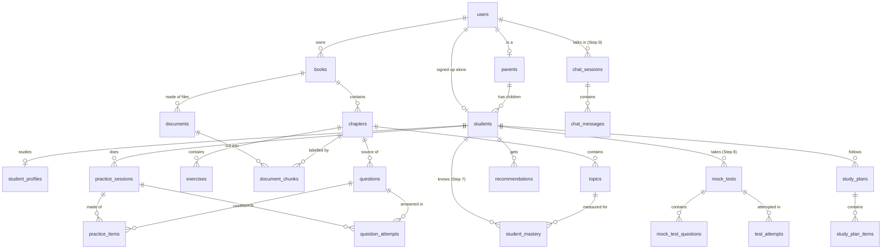

# 2. Database schema

PostgreSQL holds everything, including the vectors (through the `pgvector` extension) — one
database to run, back up and secure.

## 2.1 Conventions

| Topic | Rule |
|---|---|
| Names | `snake_case`, plural table names |
| Primary keys | UUID, generated by the application |
| Timestamps | `created_at`, `updated_at` on every table, stored with time zone (UTC) |
| Fixed vocabularies (role, class, board…) | Stored as lower-case text; the allowed values live in `app/core/enums.py`. A database `CHECK` is added only where a wrong value would break security (`users.role`) |
| Flexible data | `JSONB` (subjects, question bodies, chunk metadata) |
| Ownership | Every table with family data can be traced to one account. Deleting the owner deletes the rows (`ON DELETE CASCADE`) |
| Changes | Only through Alembic migrations — one per step, numbered `0001`, `0002`, … |

## 2.2 Tables added in Step 1 — accounts and learners

### `users` — accounts that can sign in

| Column | Type | Notes |
|---|---|---|
| `id` | uuid, PK | |
| `email` | varchar(320), unique | always stored lower-case |
| `password_hash` | varchar(255) | Argon2id |
| `full_name` | varchar(120) | |
| `role` | varchar(20) | `parent` or `student` — enforced by a CHECK |
| `preferred_language` | varchar(16) | language of the screens: `en`, `hi`, `hinglish` |
| `is_active` | boolean | `false` blocks sign-in |
| `last_login_at` | timestamptz, null | |

### `parents` — parent-only details

| Column | Type | Notes |
|---|---|---|
| `id` | uuid, PK | |
| `user_id` | uuid, unique, FK → `users.id` | one row per parent account |

Small today on purpose. Notification settings, phone number and plan details will live here.

### `students` — learners

| Column | Type | Notes |
|---|---|---|
| `id` | uuid, PK | |
| `parent_id` | uuid, null, FK → `parents.id` | set for a child added by a parent |
| `user_id` | uuid, null, unique, FK → `users.id` | set for a student who signed up alone |
| `name` | varchar(80) | |
| `age` | smallint, null | 2–25 |

CHECK: **exactly one** of `parent_id` / `user_id` is set.

### `student_profiles` — what the learner studies (one per student)

| Column | Type | Notes |
|---|---|---|
| `student_id` | uuid, PK, FK → `students.id` | |
| `class_level` | varchar(16) | `nursery`, `lkg`, `ukg`, `class_1` … `class_12` |
| `board` | varchar(16) | `cbse`, `icse`, `state`, `other` |
| `board_name` | varchar(80), null | e.g. "MP Board", only for `state` / `other` |
| `medium` | varchar(16) | medium of instruction at school |
| `primary_language` | varchar(16) | language the AI uses with this learner |
| `stream` | varchar(16), null | `science`, `commerce`, `arts` — Class 11–12 only |
| `goal` | varchar(32) | `general_learning`, `school_exam`, `board_exam`, `jee`, `neet`, `cuet`, `other` |
| `subjects` | jsonb | list of subject names |

Kept separate from `students` because it changes every year (promotion to the next class) while
the learner and their history stay the same.

## 2.3 Tables added in Step 2 — My Books

Migration `0002`. Books, documents and chunks carry `owner_user_id`; chapters, topics and exercises
are always reached through their book, so the one-column isolation rule covers all of it.

### `books` — an entry in "My Books"

| Column | Type | Notes |
|---|---|---|
| `id` | uuid, PK | |
| `owner_user_id` | uuid, FK → `users.id` | the account that owns it |
| `student_id` | uuid, null, FK → `students.id` **ON DELETE SET NULL** | the child it is for; empty = whole family. Removing a child keeps the book |
| `title` | varchar(200) | |
| `material_type` | varchar(32) | `textbook`, `notes`, `question_bank`, `previous_year_paper`, `assignment`, `study_material` |
| `class_level`, `board` | varchar(16) | taken from the child's profile when not given |
| `subject` | varchar(60) | |
| `language` | varchar(16) | language the book is written in (`en`, `hi`, `mr`…) |

### `documents` — one uploaded file and its processing state

| Column | Type | Notes |
|---|---|---|
| `book_id` | uuid, FK → `books.id` | |
| `owner_user_id` | uuid, FK → `users.id` | |
| `original_filename` | varchar(255) | shown to people only; never used as a path |
| `file_kind`, `mime_type` | varchar | `pdf` / `docx` / `txt`, decided from the content |
| `size_bytes`, `sha256` | bigint, varchar(64) | UNIQUE (`book_id`, `sha256`): the same file twice in one book is refused |
| `storage_key` | varchar(200), unique | random name in private storage |
| `page_count` | int, null | |
| `status` | varchar(16) | `queued` → `processing` → `ready` / `failed` |
| `stage` | varchar(32), null | step running now, or the one that failed: `extract_text`, `detect_chapters`, `detect_exercises`, `detect_topics`, `make_chunks` |
| `error_code` | varchar(64), null | e.g. `scanned_document`; the API turns it into a parent-friendly message |
| `attempts`, `processing_started_at`, `processing_finished_at` | | |
| `stats` | jsonb | counts only: pages, OCR pages, chapters, topics, exercises, questions, examples, chunks |

### `chapters`, `topics`, `exercises` — what was found

| Table | Columns |
|---|---|
| `chapters` | `book_id`, `document_id`, `number` (int, null), `title`, `position`, `page_start`, `page_end`, `detected_by` (`outline` / `heading` / `file`) |
| `topics` | `chapter_id`, `number` (e.g. `2.3`, null), `title`, `position`, `page_start` |
| `exercises` | `chapter_id`, `label` (e.g. `2.3`; empty for a plain "Exercises"), `position`, `page_start`, `page_end`, `question_count` |

Chapters belong to the document they were found in, so removing one file removes only its chapters.

### `document_chunks` — labelled pieces of book text

| Column | Type | Notes |
|---|---|---|
| `document_id`, `owner_user_id`, `book_id` | uuid, FK | |
| `chapter_id`, `topic_id`, `exercise_id` | uuid, null, FK | empty for front / back matter |
| `content_type` | varchar(24) | `concept`, `example`, `exercise_question`, `summary`, `other` |
| `content` | text | |
| `context_label` | varchar(400) | e.g. `Class 8 · Mathematics · Chapter 2 Linear Equations · Exercise 2.3 · Question 4` — put in front of the text when it is embedded (Step 3). Rebuilt when a parent renames a chapter or changes the book |
| `page_start`, `page_end` | int, null | |
| `position` | int | reading order in the document |
| `token_count` | int | an estimate |
| `class_level`, `board`, `subject`, `language` | varchar | copies for fast filtering, kept in step with the book |
| `meta` | jsonb | `question_number`, `example_number`, `instructions` |

Indexes: (`owner_user_id`, `book_id`), (`document_id`, `position`), `chapter_id`, `topic_id`, `exercise_id`.

Added in Step 3 (migration `0003`, which also enables the `vector` extension):

| Column | Type | Notes |
|---|---|---|
| `embedding` | `vector(768)`, null | the search vector of label + text (`intfloat/multilingual-e5-base`) |
| `embedding_model` | varchar(100), null | which model made it; cleared when the label changes, so the chunk is re-embedded |
| `search_text` | `tsvector`, generated | `to_tsvector('simple', context_label || ' ' || content)`, GIN index - keyword search |

No approximate vector index: searches always run inside one family's (usually one book's) chunks,
where an exact comparison is fast and fully accurate.

## 2.4 Tables added in Step 4 — practice

Migration `0004`.

### `questions` — the family's question bank

| Column | Type | Notes |
|---|---|---|
| `owner_user_id`, `book_id` | uuid, FK | |
| `chapter_id`, `topic_id`, `exercise_id` | uuid, null, FK | where it was written from; a question written for an exercise is filed under it |
| `origin` | varchar(16) | `generated` (textbook questions are listed from the book itself) |
| `class_level`, `subject`, `language` | varchar | |
| `format`, `style`, `difficulty` | varchar | difficulty `easy` / `medium` / `hard` within the class |
| `body` | jsonb | what is shown: `text`, and `options`, `case`, `left`/`right`, `unit` by format |
| `answer` | jsonb | never sent before answering: `option` · `value` · `accepted` · `pairs` · `model_answer` + `key_points` |
| `hints` | jsonb | 1-2 hints, gentle first |
| `solution` | jsonb | `concept`, `steps`, `final_answer` |
| `source_chunk_ids`, `page` | jsonb, int | the passages it was built on |
| `validation` | jsonb | what the independent review found |

The plan had a separate `solutions` table. A question is written in one language, with its
solution, so the solution lives on the question; "explain in Hindi" is generated on request.

### `practice_sessions`, `practice_items`, `question_attempts`

| Table | Columns |
|---|---|
| `practice_sessions` | `student_id`; place `book_id` / `chapter_id` / `exercise_id` (all empty = the learner's books of their class, `SET NULL` on delete); `question_count`, `difficulty` (+ `mixed`), `question_type` (a format or `mixed`), `language`; `status` `preparing` → `ready` → `completed` (or `failed` + `error_code`); `completed_at` |
| `practice_items` | (`session_id`, `question_id`) primary key, `position`, and the help opened: `hints_shown`, `steps_shown`, `answer_shown` |
| `question_attempts` | every answer: `student_id`, `question_id`, `practice_session_id`, `response` jsonb, `is_correct`, `feedback` (written answers), `time_taken_ms`, `hints_used`, `solution_viewed`, `difficulty` |

`practice_items` is not in the original plan: it keeps the order of a session and the help opened
before answering, which the attempt then records.

## 2.5 The whole picture

Tables marked with a step number do not exist yet.



## 2.6 Planned tables

| Table | Step | Purpose | Important columns |
|---|---|---|---|
| `student_mastery` | 7 | The learner's knowledge profile | `student_id`, `topic_id`, `mastery`, `confidence`, `attempts`, `accuracy`, `avg_time_ms`, `last_practised_at` |
| `recommendations` | 7 | "Do this next", with the reason | `student_id`, `kind`, `payload` jsonb, `reason`, `status`, `valid_until` |
| `mock_tests`, `mock_test_questions`, `test_attempts` | 8 | Tests with sections and timing; results | `student_id`, `settings` jsonb, `section`, `position`, `marks`, `score`, `started_at`, `submitted_at` |
| `study_plans`, `study_plan_items` | 8 | Plan and its daily tasks | `student_id`, `exam_date`, `daily_minutes`, `target_score`, `day`, `task` jsonb, `status` |
| `chat_sessions`, `chat_messages` | 9 | Parent assistant and student tutor conversations | `owner_user_id`, `student_id`, `kind`, `role`, `content`, `sources` jsonb |
| `student_misconceptions` | 10 | Repeated wrong patterns | `student_id`, `topic_id`, `pattern`, `evidence` jsonb, `status` |
| gamification tables | 11 | Streaks, XP, badges | decided in that step |

`?` marks an optional column. Exact columns are fixed in the step that creates the table; this list
is the plan, not a promise.

**Why `books` and `documents` are separate:** NCERT publishes a textbook as one PDF per chapter. A
parent should see *one* "Class 8 Mathematics" in the library even if it arrived as 13 files.

**Why class, board and subject are repeated on `document_chunks`:** retrieval filters on them in
the same query that ranks by similarity (spec §16). Copying three short columns avoids three joins
on the hottest query in the system.

## 2.7 Changing the schema

```bash
# inside backend/, after editing a model in app/models/
alembic revision --autogenerate -m "documents and chunks" --rev-id 0002
# read the generated file in alembic/versions/ and tidy it
alembic upgrade head
pytest tests/api/test_migrations.py
```

`test_migrations.py` fails if a model and the migrations disagree, and checks that every migration
can be undone and applied again.
