# 2. Database schema

PostgreSQL holds everything, including the vectors (through the `pgvector` extension) — one
database to run, back up and secure.

## 2.1 Conventions

| Topic | Rule |
|---|---|
| Names | `snake_case`, plural table names |
| Primary keys | UUID, generated by the application |
| Timestamps | `created_at`, `updated_at` on every table, stored with time zone (UTC) |
| Fixed vocabularies (role, class, board…) | Stored as lower-case text; the allowed values live in `app/core/enums.py`. A database `CHECK` is added only where a wrong value would break security (`users.role`) |
| Flexible data | `JSONB` (subjects, question bodies, chunk metadata) |
| Ownership | Every table with family data can be traced to one account. Deleting the owner deletes the rows (`ON DELETE CASCADE`) |
| Changes | Only through Alembic migrations — one per step, numbered `0001`, `0002`, … |

## 2.2 Tables added in Step 1 — accounts and learners

### `users` — accounts that can sign in

| Column | Type | Notes |
|---|---|---|
| `id` | uuid, PK | |
| `email` | varchar(320), unique | always stored lower-case |
| `password_hash` | varchar(255) | Argon2id |
| `full_name` | varchar(120) | |
| `role` | varchar(20) | `parent` or `student` — enforced by a CHECK |
| `preferred_language` | varchar(16) | language of the screens: `en`, `hi`, `hinglish` |
| `is_active` | boolean | `false` blocks sign-in |
| `last_login_at` | timestamptz, null | |

### `parents` — parent-only details

| Column | Type | Notes |
|---|---|---|
| `id` | uuid, PK | |
| `user_id` | uuid, unique, FK → `users.id` | one row per parent account |

Small today on purpose. Notification settings, phone number and plan details will live here.

### `students` — learners

| Column | Type | Notes |
|---|---|---|
| `id` | uuid, PK | |
| `parent_id` | uuid, null, FK → `parents.id` | set for a child added by a parent |
| `user_id` | uuid, null, unique, FK → `users.id` | set for a student who signed up alone |
| `name` | varchar(80) | |
| `age` | smallint, null | 2–25 |

CHECK: **exactly one** of `parent_id` / `user_id` is set.

### `student_profiles` — what the learner studies (one per student)

| Column | Type | Notes |
|---|---|---|
| `student_id` | uuid, PK, FK → `students.id` | |
| `class_level` | varchar(16) | `nursery`, `lkg`, `ukg`, `class_1` … `class_12` |
| `board` | varchar(16) | `cbse`, `icse`, `state`, `other` |
| `board_name` | varchar(80), null | e.g. "MP Board", only for `state` / `other` |
| `medium` | varchar(16) | medium of instruction at school |
| `primary_language` | varchar(16) | language the AI uses with this learner |
| `stream` | varchar(16), null | `science`, `commerce`, `arts` — Class 11–12 only |
| `goal` | varchar(32) | `general_learning`, `school_exam`, `board_exam`, `jee`, `neet`, `cuet`, `other` |
| `subjects` | jsonb | list of subject names |

Kept separate from `students` because it changes every year (promotion to the next class) while
the learner and their history stay the same.

## 2.3 Tables added in Step 2 — My Books

Migration `0002`. Books, documents and chunks carry `owner_user_id`; chapters, topics and exercises
are always reached through their book, so the one-column isolation rule covers all of it.

### `books` — an entry in "My Books"

| Column | Type | Notes |
|---|---|---|
| `id` | uuid, PK | |
| `owner_user_id` | uuid, FK → `users.id` | the account that owns it |
| `student_id` | uuid, null, FK → `students.id` **ON DELETE SET NULL** | the child it is for; empty = whole family. Removing a child keeps the book |
| `title` | varchar(200) | |
| `material_type` | varchar(32) | `textbook`, `notes`, `question_bank`, `previous_year_paper`, `assignment`, `study_material` |
| `class_level`, `board` | varchar(16) | taken from the child's profile when not given |
| `subject` | varchar(60) | |
| `language` | varchar(16) | language the book is written in (`en`, `hi`, `mr`…) |

### `documents` — one uploaded file and its processing state

| Column | Type | Notes |
|---|---|---|
| `book_id` | uuid, FK → `books.id` | |
| `owner_user_id` | uuid, FK → `users.id` | |
| `original_filename` | varchar(255) | shown to people only; never used as a path |
| `file_kind`, `mime_type` | varchar | `pdf` / `docx` / `txt`, decided from the content |
| `size_bytes`, `sha256` | bigint, varchar(64) | UNIQUE (`book_id`, `sha256`): the same file twice in one book is refused |
| `storage_key` | varchar(200), unique | random name in private storage |
| `page_count` | int, null | |
| `status` | varchar(16) | `queued` → `processing` → `ready` / `failed` |
| `stage` | varchar(32), null | step running now, or the one that failed: `extract_text`, `detect_chapters`, `detect_exercises`, `detect_topics`, `make_chunks` |
| `error_code` | varchar(64), null | e.g. `scanned_document`; the API turns it into a parent-friendly message |
| `attempts`, `processing_started_at`, `processing_finished_at` | | |
| `stats` | jsonb | counts only: pages, OCR pages, chapters, topics, exercises, questions, examples, chunks |

### `chapters`, `topics`, `exercises` — what was found

| Table | Columns |
|---|---|
| `chapters` | `book_id`, `document_id`, `number` (int, null), `title`, `position`, `page_start`, `page_end`, `detected_by` (`outline` / `heading` / `file`) |
| `topics` | `chapter_id`, `number` (e.g. `2.3`, null), `title`, `position`, `page_start` |
| `exercises` | `chapter_id`, `label` (e.g. `2.3`; empty for a plain "Exercises"), `position`, `page_start`, `page_end`, `question_count` |

Chapters belong to the document they were found in, so removing one file removes only its chapters.

### `document_chunks` — labelled pieces of book text

| Column | Type | Notes |
|---|---|---|
| `document_id`, `owner_user_id`, `book_id` | uuid, FK | |
| `chapter_id`, `topic_id`, `exercise_id` | uuid, null, FK | empty for front / back matter |
| `content_type` | varchar(24) | `concept`, `example`, `exercise_question`, `summary`, `other` |
| `content` | text | |
| `context_label` | varchar(400) | e.g. `Class 8 · Mathematics · Chapter 2 Linear Equations · Exercise 2.3 · Question 4` — put in front of the text when it is embedded (Step 3). Rebuilt when a parent renames a chapter or changes the book |
| `page_start`, `page_end` | int, null | |
| `position` | int | reading order in the document |
| `token_count` | int | an estimate |
| `class_level`, `board`, `subject`, `language` | varchar | copies for fast filtering, kept in step with the book |
| `meta` | jsonb | `question_number`, `example_number`, `instructions` |

Indexes: (`owner_user_id`, `book_id`), (`document_id`, `position`), `chapter_id`, `topic_id`, `exercise_id`.

Added in Step 3 (migration `0003`, which also enables the `vector` extension):

| Column | Type | Notes |
|---|---|---|
| `embedding` | `vector(768)`, null | the search vector of label + text (`intfloat/multilingual-e5-base`) |
| `embedding_model` | varchar(100), null | which model made it; cleared when the label changes, so the chunk is re-embedded |
| `search_text` | `tsvector`, generated | `to_tsvector('simple', context_label || ' ' || content)`, GIN index - keyword search |

No approximate vector index: searches always run inside one family's (usually one book's) chunks,
where an exact comparison is fast and fully accurate.

## 2.4 Tables added in Step 4 — practice

Migration `0004`.

### `questions` — the family's question bank

| Column | Type | Notes |
|---|---|---|
| `owner_user_id`, `book_id` | uuid, FK | |
| `chapter_id`, `topic_id`, `exercise_id` | uuid, null, FK | where it was written from; a question written for an exercise is filed under it |
| `origin` | varchar(16) | `generated` (textbook questions are listed from the book itself) |
| `class_level`, `subject`, `language` | varchar | |
| `format`, `style`, `difficulty` | varchar | difficulty `easy` / `medium` / `hard` within the class |
| `body` | jsonb | what is shown: `text`, and `options`, `case`, `left`/`right`, `unit` by format |
| `answer` | jsonb | never sent before answering: `option` · `value` · `accepted` · `pairs` · `model_answer` + `key_points` |
| `hints` | jsonb | 1-2 hints, gentle first |
| `solution` | jsonb | `concept`, `steps`, `final_answer` |
| `source_chunk_ids`, `page` | jsonb, int | the passages it was built on |
| `validation` | jsonb | what the independent review found |

The plan had a separate `solutions` table. A question is written in one language, with its
solution, so the solution lives on the question; "explain in Hindi" is generated on request.

### `practice_sessions`, `practice_items`, `question_attempts`

| Table | Columns |
|---|---|
| `practice_sessions` | `student_id`; place `book_id` / `chapter_id` / `topic_id` (Step 7) / `exercise_id` (all empty = the learner's books of their class, `SET NULL` on delete); `question_count`, `difficulty` (+ `mixed`), `question_type` (a format or `mixed`), `language`; `status` `preparing` → `ready` → `completed` (or `failed` + `error_code`); `completed_at` |
| `practice_items` | (`session_id`, `question_id`) primary key, `position`, and the help opened: `hints_shown`, `steps_shown`, `answer_shown` |
| `question_attempts` | every answer: `student_id`, `question_id`, `practice_session_id` (or, from Step 8, `test_attempt_id`: exactly one of the two), `response` jsonb, `is_correct`, `feedback` (written answers), `time_taken_ms`, `hints_used`, `solution_viewed`, `difficulty`, `marks` (tests) |

`practice_items` is not in the original plan: it keeps the order of a session and the help opened
before answering, which the attempt then records.

## 2.5 Tables added in Step 7 — adaptive learning

Migration `0005`. Both are about an *area*: a topic of a chapter, or the chapter itself
(`topic_id` empty) for questions that have no topic. Rows go when their learner, chapter or topic
goes (`ON DELETE CASCADE`), so a deleted book never leaves a recommendation pointing at nothing.

### `student_mastery` — what a learner knows, one row per area

| Column | Type | Notes |
|---|---|---|
| `student_id`, `chapter_id` | uuid, FK | |
| `topic_id` | uuid, null, FK | empty = the chapter in general; unique with the two above (`NULLS NOT DISTINCT`) |
| `attempts` | int | first answers in the area, all time |
| `accuracy`, `mastery`, `confidence` | float | 0-1, from the last 10 first answers (doc 7, 7.9) |
| `avg_time_ms` | int, null | |
| `last_practised_at` | timestamptz | |
| `difficulty`, `difficulty_since` | varchar(8), timestamptz, null | the level of the next practice and when it last moved; empty where the class has no adaptive difficulty |
| `examined_until` | timestamptz, null | Step 10: the newest wrong answer already looked at for misconceptions |

Worked out again from `question_attempts` after every answer, in the same transaction.

### `recommendations` — "do this next", at most three a day

| Column | Type | Notes |
|---|---|---|
| `student_id` | uuid, FK | |
| `day`, `position` | date, smallint | the day in India time; unique with `student_id` |
| `kind` | varchar(16) | `strengthen` · `continue` · `review` · `new_chapter` |
| `chapter_id`, `topic_id` | uuid, FK (topic null) | the place to practise |
| `difficulty` | varchar(8) | `easy` / `medium` / `hard` / `mixed` |
| `reason` | jsonb | why, as a code and its numbers (Step 11, so the screens word it in any language): `{"code": "weak", "accuracy": 0.2, "answers": 5, "difficulty": "easy"}` |
| `status` | varchar(8) | `active` → `done` when a practice of the place is finished |

Changed from the plan: real `chapter_id` / `topic_id` columns instead of a `payload` jsonb (so the
database removes a recommendation with its book), and `day` instead of `valid_until`.

## 2.6 Tables added in Step 8 — mock tests and study plans

Migration `0006`.

### `mock_tests`, `mock_test_questions`, `test_attempts`

| Table | Columns |
|---|---|
| `mock_tests` | `student_id`; `kind` `practice` / `chapter` / `full_mock` (Step 10: `previous_year`); `exam` (Step 10: `jee` / `neet` / `cuet`, the exam whose pattern it follows; empty = a school paper); the same question settings as a practice session (place `book_id` / `chapter_id` / `topic_id` / `exercise_id`, `question_count`, `difficulty`, `language`, `status`, `error_code` — one shared model mixin); `duration_minutes` (empty = untimed); `sections` jsonb, the paper's plan: `[{code, title, marks, negative, count, formats, chapters?}]` (`negative`: marks lost for a wrong answer; `chapters`: `{chapter_id: count}` for a previous-year pattern test) |
| `mock_test_questions` | (`mock_test_id`, `question_id`) primary key, `section` (`A`–`D`), `position` inside the section, `marks` |
| `test_attempts` | one sitting: `mock_test_id`, `student_id`, `started_at`, `submitted_at`, `responses` jsonb (answers saved while the test is taken, `{question_id: {option / value / text / pairs, time_taken_ms}}`), `score` |

Submitting turns every saved answer into a `question_attempts` row with `test_attempt_id` and its
`marks`, so progress and mastery count test answers like practice answers. A check constraint keeps
exactly one of `practice_session_id` / `test_attempt_id` filled. The plan named the settings column
`settings`; it holds the sections, so it is called `sections`. The deadline is not stored: it is
`started_at + duration_minutes`.

### `study_plans`, `study_plan_items`

| Table | Columns |
|---|---|
| `study_plans` | `student_id` (**unique**: one plan per learner), `exam_date`, `daily_minutes`, `target_score` (percent), `chapter_ids` uuid[] (empty = every chapter of the learner's books for their class), `planned_on` (the India-time day the rest was last planned), `unscheduled` (tasks that did not fit) |
| `study_plan_items` | `plan_id`, `day`, `position`, `kind` `learn` / `practice` / `test`, `book_id`, `chapter_id` (empty for a test of the whole book), `topic_id`, `difficulty`, `minutes`, `reason` (jsonb since Step 11: a code and its numbers, as for recommendations), `status` `pending` → `done` / `skipped` / `missed` |

Changed from the plan: real `book_id` / `chapter_id` / `topic_id` columns (`ON DELETE CASCADE`)
instead of a `task` jsonb, as for recommendations — a deleted book takes its tasks with it; the
request bodies for the screens are built when the plan is read.

## 2.7 Tables added in Step 9 — conversations

Migration `0007`. A conversation is about one learner and goes with them (`ON DELETE CASCADE`).

| Table | Columns |
|---|---|
| `chat_sessions` | `student_id`; `kind` `assistant` (a parent asking about this child) / `tutor` (the learner's tutor); `title` (the first question, shortened); the tutor's state: `problem` (the problem in hand), `rung` (how far up the hint ladder its help has gone, a position in `hint_1 … answer`), `hints_only` |
| `chat_messages` | `session_id`, `role` `user` / `assistant`, `content`, `sources` jsonb (the books a reply was based on), `rung` (tutor replies: the help they gave) |

Changed from the plan: no `owner_user_id` — who may see a conversation follows its learner (a
parent sees their children's; a learner sees only their own tutor). A question and its reply are
stored together, once the reply is complete.

## 2.8 Tables added in Step 10 — previous-year papers and misconceptions

Migration `0008` (also `mock_tests.exam` and `student_mastery.examined_until`, above).

| Table | Columns |
|---|---|
| `paper_analyses` | one per paper (a file of a "Previous-year papers" book): `document_id` (primary key, `ON DELETE CASCADE`), `book_id`, `status` `preparing` / `ready` / `failed`, `error_code`, what the AI read on its front page: `year`, `duration_minutes`, `negative_marks` (0 = none). Made again each time the book is analysed; removed when the file is read again |
| `paper_questions` | one per question of an analysed paper: `chunk_id` (primary key: the exercise question it is, `ON DELETE CASCADE`), `document_id` (→ `paper_analyses`), `marks` (null: not shown), `format`, and where the family's textbooks teach it: `chapter_id`, `topic_id` (`ON DELETE SET NULL`: a removed textbook leaves the question unmatched) |
| `student_misconceptions` | `student_id`, the area (`chapter_id`, `topic_id`, `ON DELETE CASCADE`), `pattern` (what the learner does wrong), `fix`, `explain_question` (asked of "Explain this"), `evidence` jsonb (ids of the question attempts that showed it), `status` `active` / `resolved`, `last_seen_at`, `resolved_at` |

The trends of a paper analysis are not stored: they are worked out from these rows when it is read,
so they follow the papers and textbooks there are now.

## 2.9 Tables added in Step 11 — streaks, XP and badges

Migration `0009` (also the `reason` columns above, from text to jsonb). Both go with the learner
(`ON DELETE CASCADE`).

| Table | Columns |
|---|---|
| `student_rewards` | one per learner, made with their first answer: `student_id` (primary key), `xp`, `right_answers` (first time), `streak`, `longest_streak`, `last_active_on` (India time), `day_answers` (first answers that day, for the day's goal) |
| `student_badges` | `student_id`, `badge` (a code of `analytics/rewards.BADGES`), unique together; `created_at` is when it was earned |

Counted as the learner works (`analytics/rewards.record`, in the answer's transaction, the reward row
locked) and never worked out again from history: a book deleted later takes no XP, streak or badge
away. Progress over time (`GET …/progress/trends`) is worked out on reading, like basic progress.

## 2.9a Table added in Step 12 — sessions

Migration `0010`. Goes with the account (`ON DELETE CASCADE`).

| Table | Columns |
|---|---|
| `auth_sessions` | one per sign-in and per child-mode session: `user_id`, `created_at`, `expires_at` (when its last token runs out; moved on at every refresh), `revoked_at` (signed out) |

Every token names its session (the `ses` claim) and every request checks it has not been revoked, in
the same query that loads the account. `POST /auth/logout` revokes it. An account's expired and
signed-out rows are deleted when it next signs in. The background jobs and the rate limits live in
Redis, not in tables.

## 2.10 The whole picture

Every table built so far.

```mermaid
erDiagram
    users ||--o| parents : "is a"
    users ||--o| students : "signed up alone"
    parents ||--o{ students : "has children"
    students ||--o| student_profiles : "studies"

    users ||--o{ books : owns
    books ||--o{ documents : "made of files"
    books ||--o{ chapters : contains
    chapters ||--o{ topics : contains
    chapters ||--o{ exercises : contains
    documents ||--o{ document_chunks : "cut into"
    chapters ||--o{ document_chunks : "labelled by"

    chapters ||--o{ questions : "source of"
    students ||--o{ practice_sessions : does
    practice_sessions ||--o{ practice_items : "made of"
    questions ||--o{ practice_items : "used in"
    practice_sessions ||--o{ question_attempts : records
    questions ||--o{ question_attempts : "answered in"

    students ||--o{ student_mastery : knows
    chapters ||--o{ student_mastery : "measured for"
    topics ||--o{ student_mastery : "measured for"
    students ||--o{ recommendations : gets
    chapters ||--o{ recommendations : "points to"

    students ||--o{ mock_tests : takes
    mock_tests ||--o{ mock_test_questions : contains
    questions ||--o{ mock_test_questions : "used in"
    mock_tests ||--o{ test_attempts : "sat in"
    test_attempts ||--o{ question_attempts : records
    students ||--o| study_plans : follows
    study_plans ||--o{ study_plan_items : contains
    chapters ||--o{ study_plan_items : "points to"

    students ||--o{ chat_sessions : "talked about in"
    chat_sessions ||--o{ chat_messages : contains

    documents ||--o| paper_analyses : "analysed as"
    paper_analyses ||--o{ paper_questions : contains
    document_chunks ||--o| paper_questions : "is"
    chapters ||--o{ paper_questions : "teaches"
    students ||--o{ student_misconceptions : shows
    chapters ||--o{ student_misconceptions : "found in"

    students ||--o| student_rewards : earns
    students ||--o{ student_badges : earns
```



All 12 steps are built; `auth_sessions` (Step 12) is the last table so far.

**Why `books` and `documents` are separate:** NCERT publishes a textbook as one PDF per chapter. A
parent should see *one* "Class 8 Mathematics" in the library even if it arrived as 13 files.

**Why class, board and subject are repeated on `document_chunks`:** retrieval filters on them in
the same query that ranks by similarity (spec §16). Copying three short columns avoids three joins
on the hottest query in the system.

## 2.11 Changing the schema

```bash
# inside backend/, after editing a model in app/models/
alembic revision --autogenerate -m "documents and chunks" --rev-id 0002
# read the generated file in alembic/versions/ and tidy it
alembic upgrade head
pytest tests/api/test_migrations.py
```

`test_migrations.py` fails if a model and the migrations disagree, and checks that every migration
can be undone and applied again.
